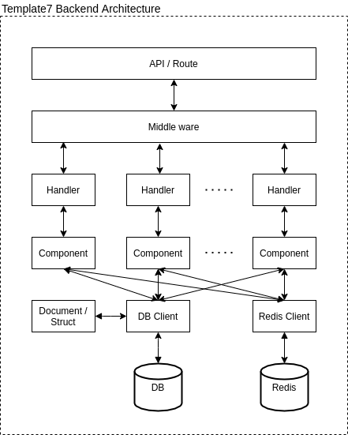

<p>
  
</p>

# Template7-Backend

[](./resource/readme/LICENSE)

Template of REST API server write by go.

[API Document](./resource/api-documentation.pdf)

## Architecture

Three layer architecture design: handler -> service -> repo

<p >
  
</p>

| Block            | Layer | Package                       | Function                                                              |
|:-----------------|:------|:------------------------------|:----------------------------------------------------------------------|
| Route            | 0     | `cmd/app.go`                  | Registered API endpoints.                                             |
| Middleware       | 0     | `internal/route/middleware`   | Request id, panic recovery, token check, RBAC permission, account status. |
| Handler          | 1     | `internal/route/handler`      | Parse URI and body, call one service, write the response (`internal/route/response`). |
| Service          | 2     | `internal/{auth,user,wallet}` | Business rules: credentials and roles, accounts, money (ownership, balances, history). |
| Repo             | 3     | `internal/db`, `internal/cache` | Storage only (MySQL via gorm, Redis); `db.Transaction` for multi-step writes. |

Errors are `t7Error` values carrying their HTTP status; handlers pass them to `response.Error`,
which writes the JSON error and logs it once.

## Configuration

Settings are read from `config/config.yaml`. Any key can be overridden with an env var:
prefix `T7_`, upper-case, `.` replaced by `_`. Secrets are **not** stored in the config file
and must be provided this way:

| Env var               | Config key           | Note                         |
|:----------------------|:---------------------|:-----------------------------|
| `T7_AUTH_JWTSECRET`   | `auth.jwtSecret`     | required, at least 32 chars  |
| `T7_DB_SQL_PASSWORD`  | `db.sql.password`    |                              |
| `T7_CACHE_PASSWORD`   | `cache.password`     |                              |

Generate a JWT secret with `openssl rand -hex 32`.

## Requirements

- Go 1.27.4 or newer (see `GO_VERSION` in `.github/workflows/test.yaml`)
- MySQL and Redis (addresses in `config/config.yaml`)

## Run

```
$ export T7_AUTH_JWTSECRET=$(openssl rand -hex 32)
$ export T7_DB_SQL_PASSWORD=...
$ make build run
```

Swagger UI is served at `/swagger/index.html` when `env: dev`.

## Development

| Command         | What it does                                                    |
|:----------------|:----------------------------------------------------------------|
| `make test`     | Unit, service and end-to-end tests with the race detector. No MySQL or Redis needed: tests use in-memory SQLite (`internal/db/dbtest`) and an in-memory cache (`internal/cache/cachetest`). |
| `make lint`     | golangci-lint (`.golangci.yml`).                               |
| `make vulncheck`| govulncheck on the module and the Go standard library.          |
| `make check`    | All of the above, same as CI.                                  |
| `make generate` | Regenerate `cmd/wire_gen.go` (Wire) and `docs/` (Swagger). CI fails if they are out of date. |
| `make build`    | Build `./bin/backend`.                                          |

Tool versions are pinned in the `Makefile`; nothing needs to be installed besides Go.

CI (`.github/workflows/test.yaml`) runs build, vet, tests, the generated-code check, lint and
govulncheck on every pull request and on pushes to `main` and `develop`.

## Docker

```
$ make image
$ docker push allensyk/template7-backend:latest
```
